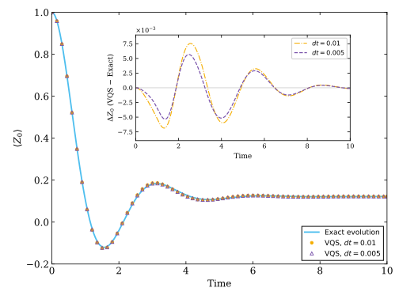
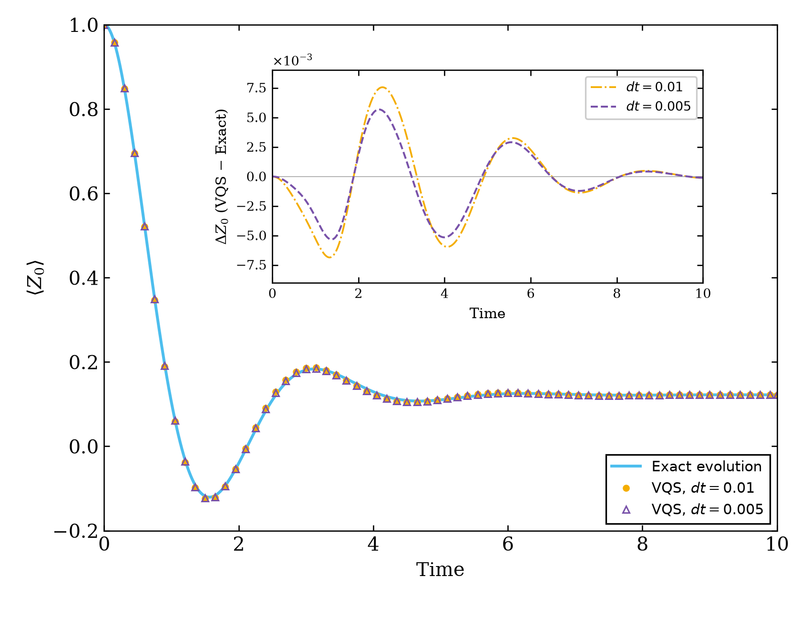
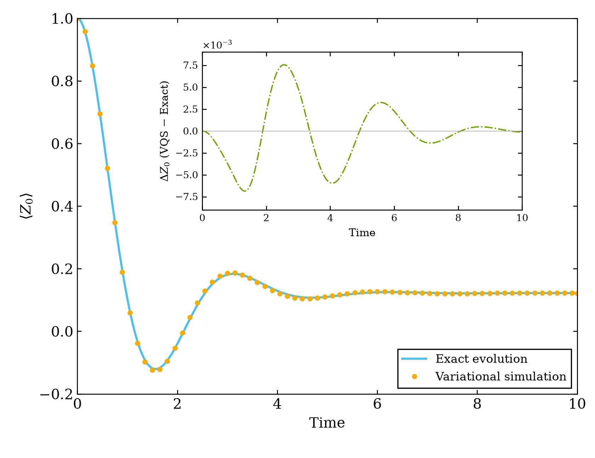

# Yuan et al. (2019) Figure 5 reproduction

Phase 6 is complete and awaiting user acceptance. The Figure 5 comparison has been generated from the accepted Exact/VQS baselines. Maximum absolute Z0 error across all 1001 saved points is **0.0075584896**, below the 0.01 comparison target. This does not establish pointwise agreement with the author's unavailable raw arrays or continuous-time/full-state accuracy.

The user subsequently authorized a separate dt=0.005 experiment while preserving the dt=0.01 results. That experiment and its overlay are complete: maximum error over 2001 points is **0.0056749235**, about 24.92% smaller. The baseline remains unchanged.

Target: mixed-state variational quantum simulation of the two-qubit Lindblad model in Figure 5 of [Yuan et al. (2019)](https://quantum-journal.org/papers/q-2019-10-07-191/).

- Exact reference: QuTiP.
- VQS: TensorCircuit with JAX automatic differentiation.
- Environment: project-local `.venv`, Python 3.12.14, pip 25.0.1, CPU only.
- Workflow: review each phase before proceeding; local commits; no push or merge without explicit approval.

See [Master Prompt](docs/Codex_Master_Prompt.md), [Mac/GitHub setup guide](docs/github_setup_zh.md), and [progress](PROGRESS.md).

The Git root is this subproject only. Literature in `/Users/ornfr/Desktop/bookandpaper` remains outside the repository and strictly read-only.

The private GitHub repository is [ORnFr/yuan2019-fig5](https://github.com/ORnFr/yuan2019-fig5). The existing remote baseline was established during Phase 0. Local `main` tracks `origin/main`. The current local branch is `presentation/vector-figures`, based on experiment commit `bef4d57`; earlier branches are preserved. No push or merge has been performed.

## Figure output format: SVG and PDF

The user requested the original thinned-marker layout and vector output for every figure. All current plotting entry points now produce **SVG and PDF only**. The 68-marker-per-run comparison layout is restored; actual data still have 1001/2001 samples. All old data and historical PNG outputs remain unchanged, and no dynamics were rerun for this format change.



Verified vector editions are in [results/vectors_20261014_183719_166716](results/vectors_20261014_183719_166716/): `exact_evolution`, `figure5_dt001`, `figure5_dt005`, `figure5_step_comparison`, each as `.svg` and `.pdf`. They are redrawn from saved arrays, never PNGs inserted into PDF/SVG wrappers. SVG stores glyph outlines; PDF embeds TrueType fonts. Curves and markers remain vector objects at any zoom.

To redraw these four existing results without recomputing dynamics:

```bash
FIG5_ROOT='/Users/ornfr/Desktop/ai小垃圾/MSVQD/reproductions/yuan2019_fig5'
PYTHONPYCACHEPREFIX="$FIG5_ROOT/work/cache/pycache" \
  "$FIG5_ROOT/.venv/bin/python" "$FIG5_ROOT/scripts/export_vector_figures.py"
```

`save_vector_figure` rejects image artists and rasterized content, writes SVG/PDF without overwriting, and checks SVG for embedded images. Independent inspection of all four PDFs finds one page each, vector drawing operators, readable Time labels and **zero embedded images**; all four SVGs likewise contain paths and zero image elements. See `vector_checks.json`. All PDFs have also been rendered for visual review with no clipping or layout defects; those temporary review images stay in ignored `work/`. The suite passed **42 tests in 7.83s**, including vector-output/no-overwrite and raster rejection checks.

The sections below retain historical numerical evidence and filenames. Those old PNGs are archival results, not the output format of future runs. Existing `run_exact.py`, `plot_figure5.py`, and `run_step_comparison.py` commands now save `.svg`/`.pdf` instead. Vector preference is recorded in AGENTS.md; generated PDFs under `results/` are allowed by `.gitignore` without admitting outside literature.

## Authorized step-size comparison



The original Figure 5 and input trajectories stay in their original run folders. The comparison runs the same six-zero initial parameters, ansatz, model, AD, SVD cutoff and parameter Forward Euler through t=10, changing only dt=.01 to .005. It separately evaluates Exact on the 2001 fine output times using unchanged adaptive DOP853 tolerances. Exact output spacing is not its internal integration step; no Exact interpolation or VQS fitting is used.

Run from any directory:

```bash
FIG5_ROOT='/Users/ornfr/Desktop/ai小垃圾/MSVQD/reproductions/yuan2019_fig5'
PYTHONPYCACHEPREFIX="$FIG5_ROOT/work/cache/pycache" \
  "$FIG5_ROOT/.venv/bin/python" "$FIG5_ROOT/scripts/run_step_comparison.py"
```

This creates a unique `results/step_comparison_<timestamp>/`. The verified run is [results/step_comparison_20261014_165015_516599](results/step_comparison_20261014_165015_516599/):

- `vqs_dt005.npz`: all 2001 states/parameters/observables and diagnostics, plus 2000 applied updates.
- `exact_dt005.npz`: independently evaluated fine-grid t/rho/z0.
- `comparison.npz`: native-grid `coarse_*` (1001 points), `fine_*` (2001 points), signed errors and `fine_minus_coarse_common` on the shared 1001 times.
- `figure5_dt005.png`: the new result alone; `figure5_step_comparison.png`: both VQS curves and both signed-error curves overlaid. Both PNGs are 1680x1296 at 240 dpi.
- `run_metadata.json`: unchanged physical/numerical choices, versions, code/data digests, actual checks and before/after hashes for all nine preserved old artifacts.

| VQS parameter step | Native-grid maximum Z0 error | Time | RMS error |
| --- | --- | --- | --- |
| .01 (preserved) | .00755848956718 | 2.56 | .00336303618991 |
| .005 (new) | .00567492350223 | 2.48 | .00262363430997 |

The maximum error decreases by 24.92%; the largest new/old Z0 difference on common times is .00238556581934 at t=2.89. Both error curves use `VQS - Exact` with every native-grid point. Display markers share .15 physical spacing (old stride15, new stride30). There is no time shift or interpolation, and no reassignment of the baseline.

All fine VQS states pass physical checks (trace error 9.992e-16, Hermiticity error zero, minimum eigenvalue zero; tolerance1e-10), parameter/time alignment and independent density reconstruction (tolerance1e-12). New Exact states agree with independent matrix-exponential propagation to 2.942e-15 and with old Exact states at common times to 1.055e-15 (reference tolerance1e-9). All NPZ arrays were read back; both PNGs were visually checked. The suite passed **39 tests in 7.98s** from outside the project. The scientific dependencies and evolution core code are unchanged.

Two step sizes show sensitivity and an observed improvement; they do not establish the convergence order or zero-step limit, and total error has not been separated into representation/discretization contributions. See [Chinese explanation](notes/step_size_comparison_zh.md). Stop after this authorized experiment.

## Figure 5: compare saved baselines



Run from any directory; no activation, dependency installation or dynamics rerun is required:

```bash
FIG5_ROOT='/Users/ornfr/Desktop/ai小垃圾/MSVQD/reproductions/yuan2019_fig5'
PYTHONPYCACHEPREFIX="$FIG5_ROOT/work/cache/pycache" \
  "$FIG5_ROOT/.venv/bin/python" "$FIG5_ROOT/scripts/plot_figure5.py"
```

Defaults explicitly select the accepted `results/exact_20261013_220047_446893/exact.npz` and `results/vqs_20261014_161232_948193/vqs.npz`; this does not select whichever run happens to be newest. To compare other recorded baselines, pass `--exact results/<exact_run>/exact.npz --vqs results/<vqs_run>/vqs.npz`. Relative paths are interpreted from the project root. Inputs must be within project `results/`, match their metadata hashes and have the same 1001-point baseline grid, model and basis. The script checks stored Z0 against density diagonals and all states' physical validity before comparing. It imports NumPy/Matplotlib, with no QuTiP/JAX/TensorCircuit import or evolution-module dependency.

Each invocation writes a unique `results/figure5_<timestamp>/`. The verified run is [results/figure5_20261014_162632_671057](results/figure5_20261014_162632_671057/):

- `figure5.png`: 1680x1296 at 240 dpi. Main panel: Exact line and VQS dots; inset: **signed** `error=z0_vqs-z0_exact`. All input times are unchanged.
- `comparison.npz`: float64 `t,z0_exact,z0_vqs,error`, each `(1001,)`, read back and checked element by element. The original rho/parameter data stay in their accepted run folders.
- `run_metadata.json`: input/output/source digests, source paper/pages, inherited model/solver/SVD choices, actual validation and full-grid error metrics, Python and installed versions.

All 1001 points determine the error metrics and inset. Only displayed VQS dots are thinned to every 15 samples, including the first/last points (68 markers). Main limits follow Figure 5: t=[0,10], Z0=[-.2,1]. The inset accommodates the full error range rather than clipping peaks to the published axis limits.

| Metric | Actual result |
| --- | --- |
| Maximum absolute signed difference | 0.0075584895671799435 |
| Location | index 256, t=2.56; signed error positive |
| Minimum signed difference | -0.006860966610591379 |
| RMS over all saved points | 0.003363036189909212 |
| Final signed difference | -0.0001371874208003776 |
| Strict sampled target `<0.01` | Met |

Independent trace loops verify both saved observables and the full error vector. Tests also cover a peak skipped by displayed markers, strict target boundary, wrong time alignment, corrupted observables/states and lower precision. The combined suite passed **36 tests in 7.97s**, run from outside the project; the PNG has been visually checked. Previously accepted dynamics and input files remain unchanged.

This reproduces the prescribed observable comparison and meets the stated deviation-scale target on the saved grid. Author raw VQS data and an explicit published inset subtraction order are unavailable; no pointwise paper-error-curve identity is claimed. The previously documented published Exact-line time-coordinate discrepancy is not corrected in this plot. Full-time convergence and separation of representation/discretization errors remain unperformed. See [Chinese reading/code guide](notes/figure5_comparison_zh.md) and [source review](papers/figure5_comparison_source_zh.md). Phase 6 is the final planned phase; stop for acceptance.

## VQS baseline: run and outputs

`mclachlan.py` evaluates the density-space Eq. (28)/(29): `M_ij=Re Tr(D_i^dagger D_j)` and `V_i=Re Tr(D_i^dagger L(rho(theta)))`. It verifies imaginary parts, symmetry and positive semidefiniteness before taking real parts. The fixed model uses all Hamiltonian and dissipative terms at the current ansatz state. VQS never reads Exact data.

`solve_svd` retains singular values `s > 6*eps(float64)*s_max` and returns the truncated minimum-norm solution. Full condition is infinity when numerical rank is below six; retained condition describes only the retained spectrum. There is no Tikhonov term or initial perturbation. At six-zero initial parameters, M has rank two and ideal singular values `(2.5,2.5,0,0,0,0)`, V is `(1,1,0,2,2,0)` and parameter velocity is `(0.4,0.4,0,0.8,0.8,0)`.

Run from any directory using the existing environment:

```bash
FIG5_ROOT='/Users/ornfr/Desktop/ai小垃圾/MSVQD/reproductions/yuan2019_fig5'
PYTHONPYCACHEPREFIX="$FIG5_ROOT/work/cache/pycache" \
  "$FIG5_ROOT/.venv/bin/python" "$FIG5_ROOT/scripts/run_vqs.py"
```

The entry point checks independent equations, the analytic initial solve, short-time parameter/time alignment, cutoff sensitivity and smaller-step diagnostics before running the baseline. `vqs.py` updates `theta[n+1]=theta[n]+0.01*theta_dot[n]`, then reconstructs rho from the circuit. It neither performs a density Euler step nor repairs the resulting state. Euler and the SVD threshold are project choices, not asserted details of the paper's implementation.

Every invocation writes a unique `results/vqs_<timestamp>/`. The verified run is [results/vqs_20261014_161232_948193](results/vqs_20261014_161232_948193/):

- `vqs.npz`: t `(1001,)`, theta/velocity `(1001,6)`, rho complex128 `(1001,4,4)`, z0 `(1001,)`, M `(1001,6,6)`, V/singular values `(1001,6)`, rank, cutoff, full/retained condition, linear/tangent residuals and physical identity diagnostics. `parameter_step` is `(1000,6)`, containing only applied updates. Other numeric arrays are float64 except int64 rank. Infinity is allowed only in documented condition diagnostics; all physical quantities and updates are finite.
- `short_diagnostics.npz`: full diagnostic trajectories to t=.2 for cutoff multipliers 1, 10, 100 and dt=.01, .005, .0025, using separate key prefixes. They do not replace the baseline.
- `run_metadata.json`: equations, choices, source PDF hash/pages, actual checks, software versions, source/data hashes, shapes and dtypes. Both NPZ files were read back and checked element by element.

Across 17 parameter cases, independent full-gate derivatives, QuTiP Liouvillian and explicit trace products agree with M/V to `1.443e-15` / `1.554e-15` (absolute tolerance `1e-12`). Eager and JIT outputs agree exactly. A direct real density-space least-squares reference, avoiding Gram formation, agrees with the velocity to `1.224e-10` (absolute tolerance `1e-9`). Synthetic inconsistent, zero and full-rank systems also verify cutoff/minimum-norm behavior and honest residuals. The combined suite passed **29 tests in 7.87s**, started outside the project; `pip check` passes with unchanged dependencies.

The full baseline has trace error `1.110e-15`, Hermiticity error zero, minimum density eigenvalue zero (physical tolerance `1e-10`), and correct parameter/time/observable alignment (tolerance `1e-12`). Eleven densities spanning the full interval agree with independent reconstruction to `1.943e-16`. Initial rank is two; the remaining 1000 sampled matrices have numerical rank six. Maximum retained condition is `3.173e8`; maximum parameter-step norm is `0.0314884`. Final `Z0(10)=0.1218784663`.

Maximum linear residual is `5.759e-15`, while maximum density-tangent residual is `0.0315028`: solving the normal equation accurately does not eliminate the ansatz representation error. Over t<=.2, increasing cutoff tenfold/hundredfold changes neither rank nor trajectory. On that short interval, successive dt=.01/.005 and .005/.0025 observable differences are `1.619e-4` and `8.365e-5`. These are short-time observations, not full-time convergence or threshold-insensitivity claims. No Exact/VQS error comparison or Figure 5 plot has been performed in Phase 5.

See [Chinese formulas and code explanation](notes/mclachlan_vqs_zh.md). Phase 5 was accepted before the separately authorized Phase 6 comparison above.

## Reduced-density Jacobian

`src/yuan2019_fig5/derivatives.py` provides `density_jacobian(theta)` for six real paper angles. It returns JAX complex128 `D[i,s,t] = partial rho_S[s,t] / partial theta_i`, shape `(6,4,4)`, in the existing system basis `|00>,|01>,|10>,|11>`. It uses `jax.jacfwd` separately on the real and imaginary density components, combines them, and moves the parameter axis from last to first. It preserves the conjugation-containing real-parameter map without `holomorphic=True`, NumPy conversion or finite differences in production.

Run from any directory:

```bash
FIG5_ROOT='/Users/ornfr/Desktop/ai小垃圾/MSVQD/reproductions/yuan2019_fig5'
PYTHONPYCACHEPREFIX="$FIG5_ROOT/work/cache/pycache" \
  "$FIG5_ROOT/.venv/bin/python" "$FIG5_ROOT/scripts/check_derivatives.py"
```

This writes a unique `results/derivatives_<timestamp>/`. The verified run is [results/derivatives_20261014_154702_356659](results/derivatives_20261014_154702_356659/):

- `derivative_samples.npz`: parameters `(17,6)`, densities `(17,4,4)`, AD and independent dense Jacobians `(17,6,4,4)`, four FD steps, per-case/parameter absolute and relative errors and their defined-relative mask. This is validation data, not an evolution trajectory.
- `run_metadata.json`: conventions, versions, code/data hashes, tolerances and actual numerical results.

All 17 cases were checked against an independent NumPy/SciPy gate-product derivative and full-density partial trace, with maximum absolute error `5.551e-16` (tolerance `1e-12`). Derivative trace error is `2.238e-16`, Hermiticity Frobenius error is zero. Central differences at `h=1e-3,1e-4,1e-5,1e-6` give maximum absolute errors `6.667e-7,6.667e-9,6.667e-11,1.474e-10`, below recorded step-dependent tolerances. Relative Frobenius errors use analytic derivative norms; directions with norms <=1e-12 have undefined relative error and must be interpreted using the saved mask, not as exact zero error. Complex-output JVP and JIT agree within tolerance. The combined suite passed **22 tests**; `pip check` still passes with unchanged dependencies.

At zero parameters, independent commutator formulas confirm `D2=D5=0`, `D3=2*D0`, `D4=2*D1`. There are two independent first-order density directions, not six. No initial perturbation, derivative normalization, symmetrization or trace repair was applied. Phase 5 preserves those derivatives and records the resulting McLachlan rank/spectrum/solve above. Derivatives are tangent matrices and are not required to be positive density matrices.

See [Chinese derivation and code notes](notes/density_derivatives_zh.md) and [source/method review](papers/phase4_derivatives_source_zh.md). Earlier Exact/ansatz/derivative code and accepted results are unchanged.

## Figure 4 ansatz and partial trace

`src/yuan2019_fig5/ansatz.py` implements the six real paper parameters with wires `(a0,a1,s0,s1)=(0,1,2,3)`, starting at `|0000>`. It applies H on both ancillae, controlled RX from a0 to s0 and a1 to s1, RZZ on the system, independent RX gates on s0/s1, and the final RZZ. Controlled rotations activate on 1.

Paper RX/RZZ gates are `exp(-i theta X)` / `exp(-i theta ZZ)`. Installed TensorCircuit 0.12.0 RX/CRX use half angles; RZZ is explicitly called with `half=True`. Each library angle is therefore `2*theta`. This was checked separately for all three gate types against SciPy matrix exponentials and every input basis column, including the control=0 case. The Hamiltonian's 1/4 coefficient is not inserted into these gates.

The public functions are `build_ansatz(theta)`, `purification_state(theta)`, `reduce_system_density(state)` and `system_density(theta)`. Parameters have shape `(6,)`, states `(16,)`, and system densities `(4,4)`. Computational arrays remain in JAX float64/complex128. For the fixed basis, reshape psi to `A[a,s]` of shape `(4,4)` and compute `rho[s,t]=sum_a A[a,s]*conj(A[a,t])`. The function neither normalizes nor clips the result. Zero parameters give the full state `|++>_A tensor |00>_S` and system density `|00><00|`.

Run the Phase 3 checks from any directory:

```bash
FIG5_ROOT='/Users/ornfr/Desktop/ai小垃圾/MSVQD/reproductions/yuan2019_fig5'
PYTHONPYCACHEPREFIX="$FIG5_ROOT/work/cache/pycache" \
  "$FIG5_ROOT/.venv/bin/python" "$FIG5_ROOT/scripts/check_ansatz.py"
```

It writes a unique `results/ansatz_<timestamp>/` without overwriting prior results. The final verification run is [results/ansatz_20261014_152519_728727](results/ansatz_20261014_152519_728727/):

- `ansatz_samples.npz`: `theta` float64 `(17,6)`, `psi` complex128 `(17,16)`, `rho` complex128 `(17,4,4)`; validation samples, not evolution data.
- `run_metadata.json`: source/basis/gate conventions, versions, seeds, code/data hashes and measured errors.

The 17 parameter cases include zero, each individual parameter, two generic cases (one maximally mixed reduced state) and eight random cases with seed 2019. Independent validation constructs 16x16 dense operators; partial trace is additionally checked by summing full-density blocks, six analytic/random examples, and QuTiP ptrace. State and density maximum absolute errors are `1.570e-16` and `2.225e-16`; tolerance is `1e-12`. Trace, Hermiticity, eigenvalues, bit significance, the Z0-to-wire2 mapping and forward-only JIT also passed. The combined suite passed **16 tests**; use the pytest command below.

The Phase 3 checks establish the circuit and forward partial trace. Derivative validation is recorded separately in the Phase 4 section above. Source/gate review: [paper notes](papers/figure4_ansatz_source_zh.md). Formula-to-code explanation: [Chinese learning notes](notes/ansatz_purification_zh.md).

## Exact evolution: run and outputs

The model is the paper's Eq. (62): `H = X tensor I + I tensor X + 0.25 Z tensor Z`, two unit-rate collapse operators `|0><1| tensor I` and `I tensor |0><1|`, initial density `|00><00|`, observable `Z tensor I`. Basis order is `|00>, |01>, |10>, |11>`; hbar=1 and time is dimensionless. There are no free fit parameters.

```bash
FIG5_ROOT='/Users/ornfr/Desktop/ai小垃圾/MSVQD/reproductions/yuan2019_fig5'
PYTHONPYCACHEPREFIX="$FIG5_ROOT/work/cache/pycache" \
  "$FIG5_ROOT/.venv/bin/python" "$FIG5_ROOT/scripts/run_exact.py"
```

This runs from any directory and writes a new `results/exact_<timestamp>/` without overwriting previous runs. It uses the existing venv; no new dependencies were installed. Exact evolution does not import TensorCircuit/JAX or read variational data. Cache setup shared with Phase 1 now lives in `src/yuan2019_fig5/runtime.py`.

The verified run is [results/exact_20261013_220047_446893](results/exact_20261013_220047_446893/):

- [exact.npz](results/exact_20261013_220047_446893/exact.npz): `t` float64 `(1001,)`, `rho` complex128 `(1001,4,4)`, `z0` float64 `(1001,)`; `t_n=0.01*n`, including 0 and 10.
- [exact_evolution.png](results/exact_20261013_220047_446893/exact_evolution.png): the Exact curve only, with the paper's main axis ranges; no variational markers or error inset.
- [run_metadata.json](results/exact_20261013_220047_446893/run_metadata.json): model, units, grid, solver options, versions, code/data hashes and actual verification/comparison errors.

QuTiP `mesolve` uses adaptive DOP853, `atol=1e-12`, `rtol=1e-10`, `normalize_output=False`; 0.01 is output spacing, not an Euler step. State trace/Hermiticity/positivity, analytic unit-rate damping, the full independently constructed NumPy generator, all 1001 states against SciPy matrix-exponential propagation, and a tighter ODE solve were checked. The maximum matrix-element discrepancy against that independent propagation is `2.844e-15` (tolerance `1e-9`). The combined Phase 1/2 suite passed: **7 tests**. Use the pytest command below to run it.

This reproduces the specified Exact dynamics, with a documented difference in the published plot's time coordinates. Direct comparison to 940 PDF cyan-line vertices gives maximum discrepancy `1.106e-2`. A possible interpretation using 1000 samples across [0,10], displayed at j*0.01 for j=1..1000, reduces it to `1.790e-6`. This is a plotting-grid hypothesis, not confirmed author source code; the saved physical data are never shifted or fitted. Details and extraction provenance: [paper notes](papers/figure5_exact_source_zh.md). The paper's VQS-versus-Exact error target is not this plot-coordinate comparison.

For the equation-to-code explanation, see [Exact learning notes](notes/exact_lindblad_zh.md). No later phase begins without the user's next instruction.

## Verified dependencies

| Package | Version |
| --- | --- |
| QuTiP | 5.2.3 |
| TensorCircuit | 0.12.0 |
| JAX / jaxlib | 0.4.38 / 0.4.38 |
| NumPy | 1.26.4 |
| SciPy | 1.15.3 |
| Matplotlib | 3.11.2 |
| pytest | 9.1.1 |

`requirements.txt` pins all 27 installed distributions, including transitive dependencies and pip. The version rationale, official sources and limitations are in [environment notes](docs/environment.md). Installation wheel URLs and SHA-256 digests are recorded in [dependency provenance](results/phase1_dependencies.json).

## Run the Phase 1 checks

The environment already exists; no activation or installation is needed to run these commands. Set the project path once:

```bash
FIG5_ROOT='/Users/ornfr/Desktop/ai小垃圾/MSVQD/reproductions/yuan2019_fig5'
mkdir -p "$FIG5_ROOT/work/cache/pycache" "$FIG5_ROOT/work/cache/pip" "$FIG5_ROOT/work/tmp"
export PYTHONPYCACHEPREFIX="$FIG5_ROOT/work/cache/pycache"
export PIP_CACHE_DIR="$FIG5_ROOT/work/cache/pip"
export PIP_CONFIG_FILE=/dev/null
export PIP_DISABLE_PIP_VERSION_CHECK=1
export TMPDIR="$FIG5_ROOT/work/tmp"
```

Run from any working directory:

```bash
"$FIG5_ROOT/.venv/bin/python" -m pip check
"$FIG5_ROOT/.venv/bin/python" "$FIG5_ROOT/scripts/check_environment.py"
PYTEST_DISABLE_PLUGIN_AUTOLOAD=1 "$FIG5_ROOT/.venv/bin/python" -m pytest \
  "$FIG5_ROOT/tests" -q \
  -o "cache_dir=$FIG5_ROOT/work/cache/pytest" \
  --basetemp="$FIG5_ROOT/work/tmp/pytest"
```

The script configures CPU, JAX x64, TensorCircuit complex128 and project-local caches before creating circuits. Inputs are five fixed angles in radians and a two-qubit Bell circuit; there is no randomness. It verifies installed pins, imports, `pip check`, actual precision, states, analytic derivatives, a complex-state Jacobian, finite differences, JIT/vmap, QuTiP matrix arithmetic and in-memory Agg rendering. A failed check exits with an error. Successful runs create a unique `results/phase1_environment_<timestamp>.json` without overwriting earlier reports. The pytest suite contains four corresponding numerical checks.

The final Phase 1 evidence is [the environment report](results/phase1_environment_20261013_212040_737785.json). It records CPU execution, float64/complex128 output, the requirements digest and actual numerical errors. Analytic and matrix comparisons use absolute tolerance `1e-12`; central-difference comparisons have separately recorded step-dependent tolerances. See [Chinese learning notes](docs/learning_zh.md) for the formulas and Python concepts.

## Recreate the environment in a new checkout

Use these commands only when that checkout has no `.venv`. Do not recreate or overwrite the existing verified environment. The base interpreter below already existed and was read without modification; a different machine needs an existing native arm64 Python 3.12 interpreter. No Python interpreter was installed for this phase.

```bash
cd "$FIG5_ROOT"
'/Users/ornfr/.cache/codex-runtimes/codex-primary-runtime/dependencies/python/bin/python3' -m venv .venv
"$FIG5_ROOT/.venv/bin/python" -m pip install \
  --index-url https://pypi.org/simple --cert /etc/ssl/cert.pem \
  --only-binary=:all: -r "$FIG5_ROOT/requirements.txt"
```

Set the local cache variables above before installation. `/etc/ssl/cert.pem` is the existing macOS CA bundle used here; no certificate checks were disabled. Run the Phase 1 checks after installation. This checkout's `.venv` refers to the existing Codex-bundled base interpreter and must be recreated if that interpreter is relocated or removed; virtual environments are not portable directories.

## Files and scope

- `scripts/check_environment.py`: standalone environment verification, not research evolution code.
- `tests/`: independent environment, Exact, ansatz, derivative and McLachlan/Euler numerical checks.
- `src/yuan2019_fig5/`: separate Exact, circuit, derivative and VQS modules with validation references.
- `scripts/run_vqs.py`: independently validated Phase 5 baseline entry point.
- `scripts/plot_figure5.py`: reads recorded Exact/VQS baselines and compares/plots them independently.
- `scripts/run_step_comparison.py`: authorized dt=.005 experiment and preserved-baseline overlay.
- `requirements.txt`: the single pinned installation specification.
- `docs/`: approved master plan, setup guide, environment rationale and Chinese learning notes.
- `results/`: tracked verification records and small Exact/VQS data; existing results are preserved.
- `.venv/` and `work/`: ignored environment, caches and temporary logs; no literature.

TensorCircuit may print notices about absent Qiskit, Cirq, Tencent cloud support and Optax during the JAX checks and VQS run. Those optional features are outside the selected JAX path and were not installed. The Exact entry point does not import JAX/TensorCircuit; the plot entry point imports none of these evolution frameworks. Full upstream suites, GPU execution and full-time convergence studies remain outside the completed work. Stop after Phase 6 and wait for the user's acceptance or next instruction.
